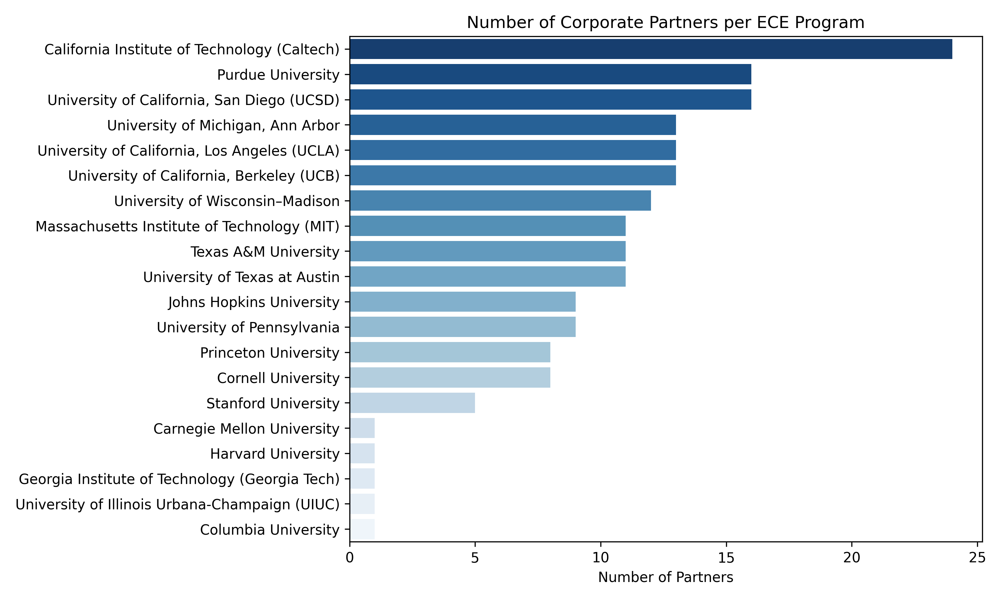
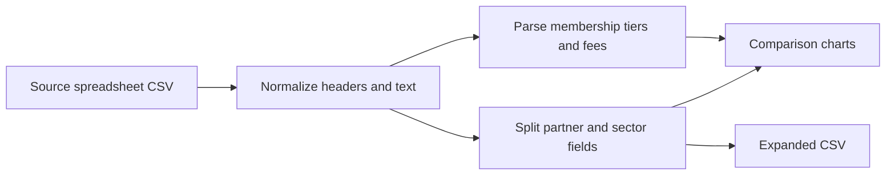

# ECE Corporate Partnership Analysis

Explore how 20 universities describe their corporate partnership programs: reported partners, technology sectors, membership tiers, and fees. This Python analysis turns a bundled research spreadsheet into comparison charts and an expanded CSV.

[Read the analysis report](<Data Analyst Programming Assignment Report.pdf>) · [Inspect the source data](<ECE Corporate Partnerships - Sheet1.csv>)



*Existing project output. Counts reflect entries in the source snapshot, including its collection and parsing limitations; they are not a verified ranking of program size.*

## Reproduce the analysis

Use Python 3.10 or 3.11 with the supplied dependency versions.

```bash
git clone https://github.com/sudhanvad18/CPP-Data-Analysis.git
cd CPP-Data-Analysis
python3 -m venv .venv
source .venv/bin/activate
python -m pip install -r requirements.txt
MPLBACKEND=Agg python Analyze.py
```

Run from the repository root: the script reads `ECE Corporate Partnerships - Sheet1.csv` by its relative filename and writes outputs into the current directory. `MPLBACKEND=Agg` runs plotting without an interactive window. To use the script’s interactive display instead, run `python Analyze.py` and close the plot window to let execution finish.

The bundled input contains **20 rows and 8 columns**. A successful run prints the loaded dimensions, processes the partnership fields, saves charts, and exports `ece_partnerships_cleaned.csv`. Existing output files with the same names are replaced.

## Analysis pipeline



The input records each university’s program level, corporate partners, sectors, membership tiers, tier benefits, fees, and reference website. The script uses pandas and NumPy for transformations, with Matplotlib and seaborn for visualization.

## Outputs

| Output | What it shows |
| --- | --- |
| `partners_per_college.png` | Number of partner entries parsed for each institution. |
| `sector_frequency.png` | Sector appearances after partner/sector expansion. |
| `membership_tier_count_distribution.png` | Distribution of parsed membership tier counts. |
| `membership_fees.png`, `membership_fees_dist.png` | Approximate fee values extracted from source text. |
| `dept_vs_ece_comparison.png` | Grouping based on the script’s program-level rule. |
| `company_frequency_distribution.png` | Distribution of parsed company-name appearance counts. |
| `ece_partnerships_cleaned.csv` | Dataset expanded to one row per parsed partner entry. |

The repository also retains other historical figures and the PDF report. `Analyze.py` currently generates the seven PNG files listed above; it does not regenerate every tracked figure.

## Interpretation and limitations

This is an exploratory analysis of a collected snapshot, not a comprehensive or current inventory of university partnerships.

- Text placeholders and missing values are not consistently excluded before partner counting. Counts can therefore include entries that are not company names.
- Sector frequency is computed after expanding partner rows; repeated sector labels can reflect that expansion rather than distinct partnerships.
- Fee extraction takes the first matching numeric substring. Ranges, shorthand amounts, and context can be misinterpreted; inspect `Fee Info` before comparing fees.
- Tier counts use comma-separated text, and program-level categories use a simple string rule. These are parsing conventions, not validated classifications.

Use the source spreadsheet and its reference websites to check any specific conclusion. The next substantive improvement is validating these transformations before publishing numerical comparisons as findings.
